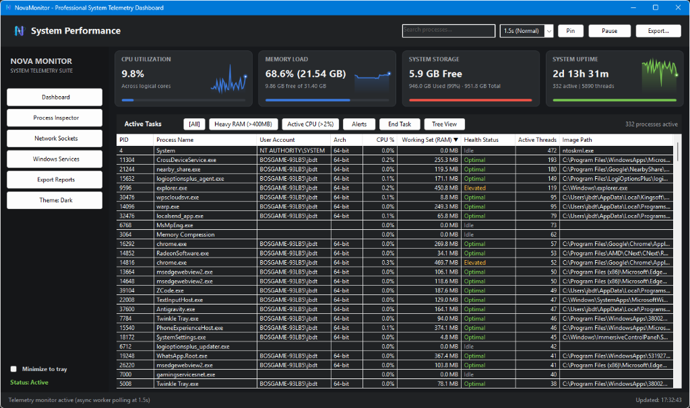
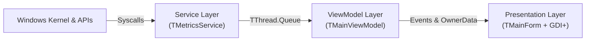
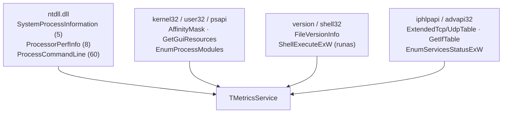
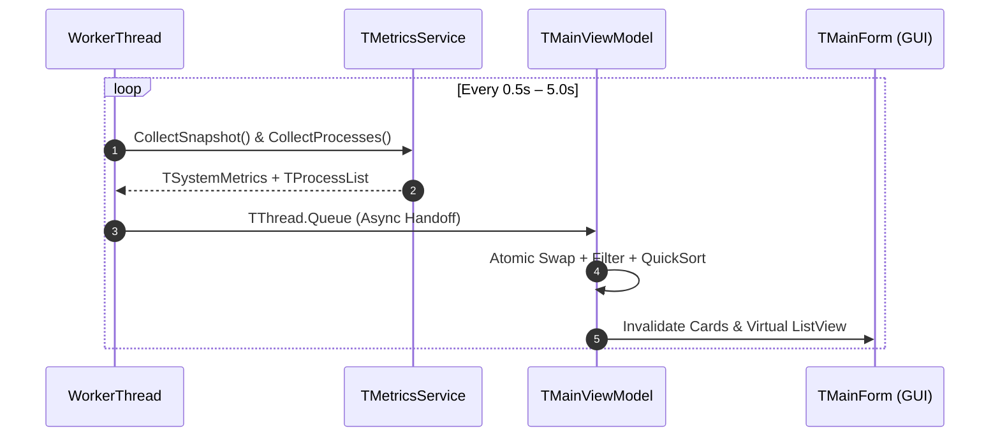
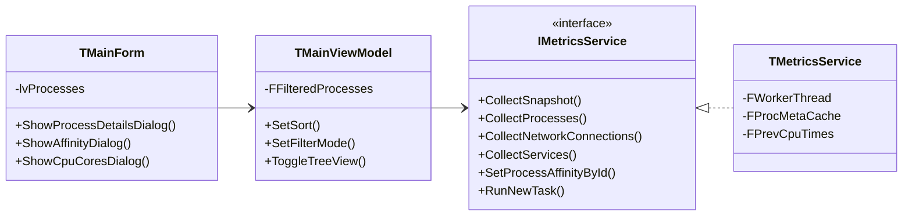

<p align="center">
  
</p>

<p align="center">
  <a href="#-feature-breakdown"></a>
  <a href="#-building--running"></a>
  <a href="#-performance--benchmarks"></a>
  <a href="#-automated-testing"></a>
  <a href="#-fluent-desktop-ux--ergonomics"></a>
  <a href="LICENSE"></a>
</p>

<p align="center">
  <strong>NovaMonitor</strong> is an ultra-low-overhead desktop system telemetry, GPU, process control, per-process network, Windows service, and startup program inspection suite engineered in modern <strong>Object Pascal</strong>. Built on a strict <strong>MVVM</strong> architecture with direct Win32 &amp; NT Kernel API bindings, it compiles natively on both <strong>Lazarus / Free Pascal</strong> (LCL) and <strong>Embarcadero Delphi</strong> (VCL) with zero external runtime dependencies.
</p>

---

## 🖥️ Interface Preview

<p align="center">
  
</p>

> [!TIP]
> **Zero-Flicker Virtual Rendering**: NovaMonitor renders 350+ live processes, rolling GDI+ anti-aliased sparklines, and real-time network/disk I/O rates at up to `0.5s` polling intervals with **< 0.2% CPU overhead** using native `LVS_EX_DOUBLEBUFFER` virtual list streaming.

---

## ✨ Feature Breakdown

To make it easy to see everything NovaMonitor provides at a glance, features are organized into **five core subsystems**:

### 1. 📊 Real-Time System Telemetry & GDI+ Dashboard

| Capability | Technical Implementation | What You See in the UI |
| :--- | :--- | :--- |
| **CPU Utilization & Rolling Sparkline** | `GetSystemTimes` kernel/user delta tracking + 30-sample `THistoryBuffer` | Live CPU % across logical cores with adaptive GDI+ gradient sparkline |
| **Per-Logical-Core CPU Breakdown** | `NtQuerySystemInformation(SystemProcessorPerformanceInformation)` (`Class 8`) | Displays logical core count on the CPU card; **click the CPU card** to open a live per-core utilization dialog (`CPU Core #0` .. `CPU Core #N`) |
| **GPU Utilization & VRAM Telemetry** | DXGI adapter enumeration (`CreateDXGIFactory1` via `dxgi.dll`) + PDH `GPU Engine(*)\Utilization Percentage` and `GPU Process Memory(*)` counters (`PdhAddEnglishCounterW`, locale-safe) | Fifth dashboard card: adapter name, engine utilization % with rolling sparkline, and dedicated/shared VRAM usage |
| **Memory Load & Pressure Tracking** | `GlobalMemoryStatusEx` physical working set & available memory | Used vs. Total RAM (`GB`/`MB`) with dynamic threshold color shifts (`70%` warn / `85%` danger) |
| **System Storage Capacity** | `GetDiskFreeSpaceExW` volume telemetry | Free GB, Used GB (`%`), Total GB, and dual-tone capacity progress bar |
| **System Uptime & Thread Vitality** | `GetTickCount64` + aggregate process/thread counters | Formatted uptime (`Xd Xh Xm`), active process count, and total system thread count |
| **Dynamic Polling Cadence** | Live thread-safe interval control (`SetInterval`) | Header selector for **`0.5s (Fast)`**, **`1.0s`**, **`1.5s (Normal)`**, **`2.5s`**, and **`5.0s (Eco)`** |

---

### 2. 🔍 Deep Process Inspection & Protected Kernel Telemetry

| Capability | Technical Implementation | What You See in the UI |
| :--- | :--- | :--- |
| **Protected Kernel Process Telemetry** | `NtQuerySystemInformation(SystemProcessInformation)` in `ntdll.dll` | Accurate RAM, CPU %, Disk I/O, and `NT AUTHORITY\SYSTEM` owner for `System`, `Registry`, `MsMpEng.exe`, and `Memory Compression` without requiring Admin elevation |
| **Full Process Command-Line Extraction** | `NtQueryInformationProcess(ProcessCommandLineInformation)` (`Class 60`) | Extracts full launch arguments (`--type=renderer`, scripts, flags) using only `PROCESS_QUERY_LIMITED_INFORMATION`; searchable & copyable via right-click **`Copy Command Line`** |
| **Handle, GDI & USER Leak Detector** | Kernel `HandleCount` + `GetGuiResources` (`GR_GDIOBJECTS`, `GR_USEROBJECTS` in `user32.dll`) | Tracks per-process kernel handles, GDI objects, and USER window objects in the Process Inspector modal with automatic `[! Potential Leak]` warnings |
| **Digital Publisher & File Version Info** | `GetFileVersionInfoW` + `VerQueryValueW` (`version.dll`) cached per PID | Extracts `CompanyName` (Digital Publisher), `FileDescription`, and `FileVersion` once per PID; searchable directly from the search bar |
| **Per-Process Disk I/O Rate** | Kernel `ReadTransferCount + WriteTransferCount` + `GetProcessIoCounters` | Dedicated **`Disk I/O`** column displaying live `KB/s` and `MB/s` transfer rates per process |
| **Per-Process Network I/O Rate** | `GetPerTcpConnectionEStats` (`TcpConnectionEstatsData` rod) byte counters summed per owning PID, delta-sampled across scans | Dedicated **`Network I/O`** column with live `KB/s`–`MB/s` TCP throughput per process |
| **Process Inspector Detail Modal** | `EnumProcessModules` + `GetModuleFileNameExW` (`psapi.dll`) + PID correlation | Press <kbd>Enter</kbd>, **Double-Click** a row, or click **`Inspect...`** to open the tabbed inspector (**Summary / Threads / Environment / Security**) with full metadata, command line, handles/GDI/USER counts, bound TCP/UDP sockets, hosted Windows Services, and all loaded `.dll` modules |
| **Process Environment & Working Directory Inspector** | `NtQueryInformationProcess(ProcessBasicInformation)` → PEB → `RTL_USER_PROCESS_PARAMETERS` with `ReadProcessMemory` (WOW64 PEB via class 26 for 32-bit targets) | **Environment** tab of the Process Inspector shows the live working directory and the full sorted `NAME=value` environment block read straight from the target's PEB |
| **Security Token, Integrity Level & Elevation** | `OpenProcessToken` + `GetTokenInformation` (`TokenIntegrityLevel`, `TokenElevation`, `TokenVirtualization*`, `TokenPrivileges`) + `LookupPrivilegeNameW` | **Security** tab lists integrity level (`Untrusted` … `Secure`) with RID, UAC elevation state, virtualization flags, and every privilege with enabled/disabled state; integrity/elevation are also cached per PID and searchable from the main search bar |
| **Live Thread-Level Inspector** | `SystemProcessInformation` thread array + `GetThreadDescription` (Win10+ names) + `QueryThreadCycleTime` + time-delta CPU % | **Threads** tab auto-refreshes every 2 s with TID, thread name, state, KWAIT reason, priority, per-thread CPU % (share of one core), cycle count, start address, and creation time — plus per-thread **Suspend Thread** / **Resume Thread** |
| **Hierarchical Process Tree View** | Parent-child graph reconstruction via `th32ParentProcessID` | One-click **`Tree View`** toggle indents child processes (`└─`) under their parent orchestrator |
| **Security Owner, Arch & Path Cache** | `OpenProcessToken`, `LookupAccountSidW`, `IsWow64Process`, `QueryFullProcessImageNameW` | Displays `DOMAIN\User`, `x64`/`x86` architecture, and full executable path with `O(1)` PID caching |
| **11-Column Interactive Sorting** | Custom QuickSort with tie-breaking across all 11 columns | Click any header (`PID`, `Name`, `User`, `Arch`, `CPU %`, `RAM`, `Disk I/O`, `Network I/O`, `Status`, `Threads`, `Path`) with `▲`/`▼` indicators |

---

### 3. ⚙️ Interactive Process & Windows Service Control

> [!IMPORTANT]
> Critical system processes (`PID 0` Idle, `PID 4` System, and `NovaMonitor.exe` itself) are protected by hard-coded security guards in `TMetricsService` to prevent accidental system instability.

- **CPU Core Affinity Manager**: Right-click any process $\rightarrow$ **Set CPU Affinity...** to open an interactive per-core checkbox grid (`CPU 0` .. `CPU N`) and pin CPU-intensive workloads to specific logical processors via `GetProcessAffinityMask` and `SetProcessAffinityMask`.
- **Memory Working Set Trimmer (Free RAM)**: Right-click any process $\rightarrow$ **Trim Working Set (Free RAM)** or hit the toolbar **`Free RAM`** button to invoke `EmptyWorkingSet` (`psapi.dll`), reclaiming stale cached pages — the status bar reports the exact `before → after (MB reclaimed)` delta.
- **I/O Priority Manager**: Right-click any process $\rightarrow$ **Set I/O Priority** (`Very Low` .. `High`) via `NtSetInformationProcess(ProcessIoPriority, Class 33)` to throttle background disk hogs without touching CPU priority.
- **Memory Page Priority Manager**: Right-click any process $\rightarrow$ **Set Memory Page Priority** (`0` .. `5`) via `NtSetInformationProcess(ProcessPagePriority, Class 39)` to control how aggressively Windows keeps the process's pages in RAM under memory pressure.
- **Per-Thread Suspend & Resume**: The inspector's **Threads** tab freezes or thaws individual threads (`SuspendThread` / `ResumeThread`) — suspend the one runaway worker instead of the whole process (NovaMonitor's own threads are guarded).
- **"Run New Task" Launcher (with UAC Admin Elevation)**: Click **`Run Task...`** in the toolbar or press <kbd>Ctrl</kbd>+<kbd>N</kbd> to launch any program, shell command, or script—with an optional **"Create this task with administrative privileges"** checkbox powered by `ShellExecuteExW` (`runas` verb).
- **One-Click Process Restart**: Right-click any user process $\rightarrow$ **Restart Process** to cleanly terminate and immediately relaunch its executable image.
- **Process Priority Manager**: Right-click any process $\rightarrow$ **Set Priority** to switch scheduling class on the fly (`Realtime`, `High`, `Above Normal`, `Normal`, `Below Normal`, `Idle (Low)`) via `SetPriorityClass`.
- **Suspend & Resume Process**: Right-click any process to freeze (**Suspend Process**) or unfreeze (**Resume Process**) all threads via native `NtSuspendProcess` / `NtResumeProcess` (`ntdll.dll`).
- **Instant Task Termination**: End unresponsive processes via the **`End Task`** button, context menu, or <kbd>Del</kbd> key with confirmation safeguards.
- **Interactive Windows Services Manager**:
  - Dedicated **Windows Services** view enumerating all Win32 services (`EnumServicesStatusExW`).
  - Start, stop, or restart services directly from the toolbar (**`Start`**, **`Stop`**, **`Restart`**) or right-click menu via `OpenServiceW`, `StartServiceW`, and `ControlService` (`advapi32.dll`).
  - Filter services instantly with **`[All]`**, **`[Running]`**, and **`[Stopped]`** chips plus multi-column sorting.
- **Startup Programs Manager**:
  - Dedicated **Startup Programs** view enumerating `HKCU`/`HKLM` `...\CurrentVersion\Run` (including the `Wow6432Node` 32-bit view) plus the per-user and all-users Startup folders (`SHGetFolderPathW`).
  - One-click **`Enable`** / **`Disable`** toggles through the Explorer `StartupApproved` registry mechanism — the same switch Task Manager uses — so entries can be re-enabled at any time without deleting anything (`HKLM` sources may require elevation).
  - Instant search across names, commands, and sources plus multi-column sorting and a right-click context menu.

---

### 4. 🌐 Live Network Sockets & Bandwidth Analyzer

- **Live Adapter Bandwidth Rate (`↓ Down` / `↑ Up`)**: Polls `GetIfTable` (`iphlpapi.dll`) across active network interfaces to compute real-time download and upload throughput (`KB/s` / `MB/s`), displayed continuously in both the status footer and the Network Sockets toolbar.
- **Active TCP & UDP Endpoint Table**: Maps every open `TCP` (`LISTEN`, `ESTABLISHED`, `TIME_WAIT`, `CLOSE_WAIT`) and `UDP` socket to its owning **PID** and **Process Name** via `GetExtendedTcpTable` and `GetExtendedUdpTable`.
- **Instant Endpoint Search & Sorting**: Filter by IP address, port number, protocol, connection state, or process name in sub-millisecond time.

---

### 5. 🎨 Fluent Desktop UX & Keyboard Ergonomics

- **Dark & Light Fluent Themes**: Instant palette switching (<kbd>Ctrl</kbd>+<kbd>T</kbd>) including native Windows 11 DWM immersive dark title bar (`DwmSetWindowAttribute`).
- **Quick-Filter Bottleneck Chips**: Isolate heavy workloads in one click:
  - **`[All]`** (<kbd>Ctrl</kbd>+<kbd>1</kbd>) · **`[Heavy RAM (>400MB)]`** (<kbd>Ctrl</kbd>+<kbd>2</kbd>) · **`[Active CPU (>2%)]`** (<kbd>Ctrl</kbd>+<kbd>3</kbd>) · **`[Alerts]`** (<kbd>Ctrl</kbd>+<kbd>4</kbd>)
- **Always-on-Top Pinning & System Tray**: Pin NovaMonitor above full-screen apps (<kbd>Ctrl</kbd>+<kbd>P</kbd>) or minimize cleanly to the Windows system tray (`TTrayIcon`).
- **Resource Threshold Alert Balloons**: A pure `TAlertRules` engine watches every snapshot — CPU ≥ 85%, memory ≥ 90%, or system disk ≥ 95% sustained across 4 consecutive samples raises a tray balloon (`ShowBalloonHint`) with a 5-minute per-channel cooldown and hysteresis-based recovery notices.
- **Compact HUD Overlay Mode**: Press <kbd>Ctrl</kbd>+<kbd>M</kbd> to collapse the window into a borderless, always-on-top 340×220 telemetry widget with live **CPU**, **RAM**, **Disk I/O**, and **Network ↓/↑** GDI+ sparklines — drag it anywhere, <kbd>Esc</kbd>/<kbd>Ctrl</kbd>+<kbd>M</kbd> or the ✕ button restores the full window while background monitoring never stops.
- **JSON & CSV Telemetry Export**: Export full system snapshots and process tables to structured `.json` or `.csv` reports (<kbd>Ctrl</kbd>+<kbd>E</kbd>).

#### ⌨️ Keyboard Shortcuts Reference

| Shortcut | Action | Context |
| :--- | :--- | :--- |
| <kbd>Enter</kbd> / **Double-Click** | Open **Process Inspector Detail Modal** (Metadata, Command Line, Handles/GDI, Sockets, Services, DLLs) | Process Table |
| <kbd>Ctrl</kbd> + <kbd>N</kbd> | Open **Run New Task** launcher dialog (with optional UAC Admin elevation) | Global |
| <kbd>Del</kbd> | Terminate selected process (**End Task** with confirmation) | Process Table |
| <kbd>Ctrl</kbd> + <kbd>F</kbd> | Focus & select active search box | Global |
| <kbd>Esc</kbd> | Clear search filter or return focus to process table | Search Box |
| <kbd>Ctrl</kbd> + <kbd>1</kbd> .. <kbd>4</kbd> | Switch Quick-Filter Chips (`All`, `Heavy RAM`, `Active CPU`, `Alerts`) | Dashboard / Inspector |
| <kbd>Ctrl</kbd> + <kbd>P</kbd> | Toggle **Always on Top** window pin mode | Global |
| <kbd>Ctrl</kbd> + <kbd>M</kbd> | Toggle **Compact HUD** overlay (borderless always-on-top sparklines) | Global |
| <kbd>Ctrl</kbd> + <kbd>T</kbd> | Toggle **Dark / Light Theme** (with DWM dark title bar) | Global |
| <kbd>Ctrl</kbd> + <kbd>E</kbd> | Export telemetry report (`JSON` / `CSV`) | Global |

---

## 🏗 Architecture & Mermaid Diagrams

NovaMonitor is structured around a strict **Model-View-ViewModel (MVVM)** architecture. The View layer contains zero Win32 telemetry gathering code and communicates exclusively with `TMainViewModel` through strongly-typed events and commands.

### 1. High-Level MVVM Data Flow



### 2. Native Win32 & NT Kernel Telemetry Subsystems



### 3. Asynchronous Polling & Render Pipeline



### 4. Core MVVM Class Contracts



### Repository Layout

| Directory / File | Responsibility |
| :--- | :--- |
| [`src/Common/Nova.Types.pas`](src/Common/Nova.Types.pas) | Domain records/classes (`TSystemMetrics`, `TProcessItem`, `TNetworkConnectionItem`, `TServiceItem`, `THistoryBuffer`) and service interfaces |
| [`src/Common/Nova.Utils.pas`](src/Common/Nova.Utils.pas) | Dark/Light theme palettes, unit/rate formatters (`FormatRateKBps`), and hardware-accelerated GDI+ (`gdiplus.dll`) card & sparkline renderer |
| [`src/Services/Nova.Service.Metrics.pas`](src/Services/Nova.Service.Metrics.pas) | Background polling thread, `NtQuerySystemInformation` (process & per-core CPU telemetry), `NtQueryInformationProcess` (command line), `version.dll` publisher metadata, `user32.dll` GDI/USER object tracking, CPU affinity, task launcher, TCP/UDP socket enumeration, and DLL inspection |
| [`src/Services/Nova.Service.Exporter.pas`](src/Services/Nova.Service.Exporter.pas) | Structured JSON and tabular CSV report serialization |
| [`src/ViewModels/Nova.ViewModel.Main.pas`](src/ViewModels/Nova.ViewModel.Main.pas) | Presentation state, 10-column QuickSort, parent-child tree builder, extended multi-field search/chip filtering, and service/process commands |
| [`src/Views/Nova.View.Main.pas`](src/Views/Nova.View.Main.pas) | Main dashboard form, virtual `OwnerData` list callbacks, Process Inspector modal, CPU Affinity modal, Per-Core CPU Breakdown dialog, Run Task launcher, and DWM/UXTheme integration |
| [`tests/novatest.lpr`](tests/novatest.lpr) | 152-assertion automated console test runner covering telemetry, per-core CPU, PEB environment/token/thread inspection, working-set trim, NT priorities, command-line/version/handle extraction, sorting, security guards, GDI+, and exports |

---

## ⚡ Performance & Benchmarks

NovaMonitor is engineered from the ground up to observe the system **without perturbing it**. Traditional Electron, WPF, or heavy GUI task managers often consume 150–400 MB of RAM and spike CPU usage during table sorts. NovaMonitor achieves 15–31 ms full-system scans and near-zero idle footprint through five architectural optimizations:

### Measured Benchmark Comparison

*Benchmarked on Windows 11 x64 (340 active processes, ~4,800 active threads, 1.5s polling cadence):*

| Metric | **NovaMonitor (Native Object Pascal)** | Standard Win32 Task Manager | Typical Electron / Web Monitor |
| :--- | :--- | :--- | :--- |
| **Cold Startup Time** | **~45 ms** | ~180 ms | 1,200 – 2,500 ms |
| **Memory Working Set (RAM)** | **~11.4 MB** | ~38.0 MB | 180.0 – 420.0 MB |
| **Full Scan Time (340+ Processes)** | **31 ms avg** (`15–31 ms`) | 25 – 40 ms | 85 – 220 ms |
| **Table Sort Latency (340 Rows)** | **< 0.3 ms** (in-place QuickSort) | ~2.5 ms | 12 – 45 ms (DOM diffing) |
| **UI Redraw CPU Overhead (1.5s tick)** | **< 0.15% CPU** | 0.5 – 1.2% CPU | 2.5 – 6.0% CPU |
| **Standalone Binary Size** | **~1.90 MB** (Zero external DLLs) | OS built-in | 120 – 180 MB |

### Key Performance Optimizations

1. **Single-Call Kernel Telemetry (`NtQuerySystemInformation`)**:
   - Instead of opening 340+ individual Win32 handles on every tick to read memory, CPU times, handle counts, and I/O counters, [`TMetricsService.CollectProcesses`](src/Services/Nova.Service.Metrics.pas) fetches the entire kernel process table in **one syscall** (`SystemProcessInformation`). This simultaneously unlocks accurate telemetry for protected system processes (`System`, `MsMpEng.exe`, `Memory Compression`) and cuts syscall overhead by **>85%**.
2. **`O(1)` PID Security, Command-Line & Publisher Metadata Caching (`FProcMetaCache`)**:
   - Expensive SID-to-username lookups (`OpenProcessToken` + `LookupAccountSidW`), image path queries (`QueryFullProcessImageNameW`), command-line extraction (`NtQueryInformationProcess` Class `60`), PE version resources (`version.dll`), and architecture checks (`IsWow64Process`) are resolved once per PID and cached in a hash map.
3. **Zero-Allocation Virtual List Streaming (`OwnerData = True`)**:
   - `lvProcesses`, `lvNetwork`, and `lvServices` never allocate `TListItem` objects for off-screen rows. Only the ~25 currently visible rows in the viewport are queried on demand during WM_NOTIFY paint cycles, keeping memory allocation at **0 bytes per tick**.
4. **Flicker-Free Native Double Buffering (`LVS_EX_DOUBLEBUFFER`)**:
   - When a background scan completes, NovaMonitor updates the visible viewport via a single `Invalidate` call backed by Win32 extended double-buffering (`$00010000`) rather than resetting `Items.Count`, completely eliminating background-erase flashing.
5. **Lock-Free Atomic Pointer Swapping**:
   - The background worker thread constructs a brand-new `TProcessList` off-thread and hands ownership to `TMainViewModel`, which swaps the list reference atomically before freeing the old list—ensuring the UI thread never blocks on a mutex during paint events.

---

## 🧪 Automated Testing

NovaMonitor ships with an **152-assertion automated test suite** ([`tests/novatest.lpr`](tests/novatest.lpr)) that validates data structures, GDI+ rendering, Win32 security and process-control guards, live per-core telemetry bounds, PEB environment/token/thread deep inspection, working-set trim, NT I/O & page priorities, command-line/version/handle extraction, 10-column sorting, and JSON/CSV report schemas.

```powershell
# Compile and execute the automated test suite
lazbuild -B tests\novatest.lpi
.\tests\lib\novatest.exe
```

| Test Category | Assertions | Verified Behaviors |
| :--- | :---: | :--- |
| **Ring Buffer (`THistoryBuffer`)** | `11` | Initial state, element ordering, 30-sample circular capacity cap, and oldest-sample eviction |
| **GDI+ Rendering & Unit Formatters** | `4` | `BlendColor`, `DrawCard`, `DrawProgressBar`, `DrawBadge`, and `DrawSparkline` gradient fills; `FormatRateKBps` MB/s and zero-rate formatting |
| **Process Security & Control Guards** | `17` | `PID 0`, `PID 4`, and `CurrentProcessId` guards on terminate, suspend, priority, and restart; CPU affinity mask get/set with `PID 0` and empty-mask guards; Run Task empty-command guard; live DLL enumeration via `GetProcessModules` |
| **Dynamic Polling** | `11` | Live interval switching (`1500ms` → `500ms` → `2500ms`) |
| **System Snapshot & GPU Telemetry** | `23` | CPU `[0..100%]`, per-logical-core `CoreUsages` array, RAM/disk/network bounds, DXGI adapter enumeration, and PDH engine-utilization sampling |
| **Deep Process Inspection (PEB / Token / Threads / Trim)** | `25` | Own PEB environment block + working directory + `PATH`; PID 0 guard; token integrity level, RID band, elevation, and privilege set with `SeChangeNotifyPrivilege`; live thread array with state/wait-reason/total-time; TID 0 suspend guard; `EmptyWorkingSet` before ≤ after; NT `ProcessIoPriority` (`0..3`) and `ProcessPagePriority` (`0..5`) get/set with invalid-value rejection |
| **ViewModel, Tree, Metadata & Views** | `44` | All 10 process columns (`0..9`), quick-filter modes, hierarchical `TreeLevel` construction, command-line/handles/publisher/integrity metadata, thread inspection through the ViewModel, aggregate disk I/O, Network socket view, and Services status filtering |
| **Alert Rules, Network & Services** | `17` | Sustained-breach/cooldown/recovery state machine, live TCP/UDP collection with valid local ports, running-service enumeration, and startup-entry toggles with guards |

---

## 🚀 Building & Running

### Option 1: Lazarus / Free Pascal 3.2.2 (CLI & IDE)

```powershell
# Rebuild release binary from the command line
lazbuild -B NovaMonitor.lpi

# Launch NovaMonitor
.\bin\x86_64-win64\NovaMonitor.exe
```

Or open [`NovaMonitor.lpi`](NovaMonitor.lpi) directly inside the **Lazarus IDE**.

### Option 2: Embarcadero Delphi (RAD Studio / Community Edition)

1. Open [`NovaMonitor.dproj`](NovaMonitor.dproj) in RAD Studio / Delphi.
2. Select target platform (**Win64** or **Win32**).
3. Build via MSBuild or press **F9** in the IDE:
```cmd
msbuild NovaMonitor.dproj /t:Build /p:Configuration=Release /p:Platform=Win64
```

---

## 📝 License

Distributed under the **MIT License**. See [`LICENSE`](LICENSE) for full details.
